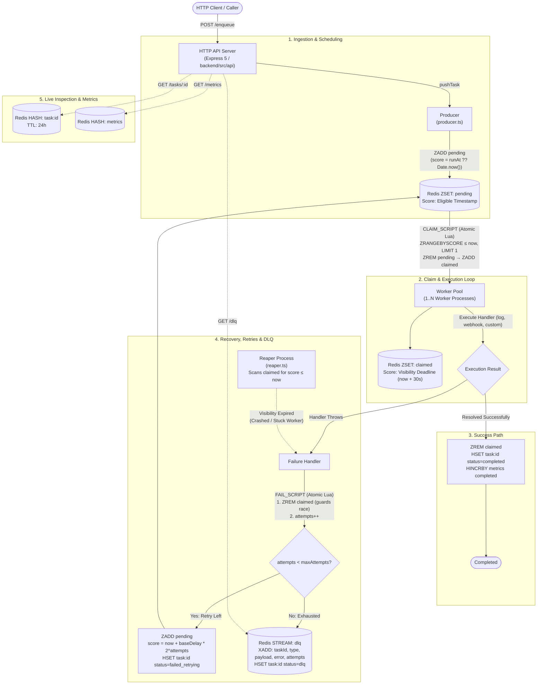
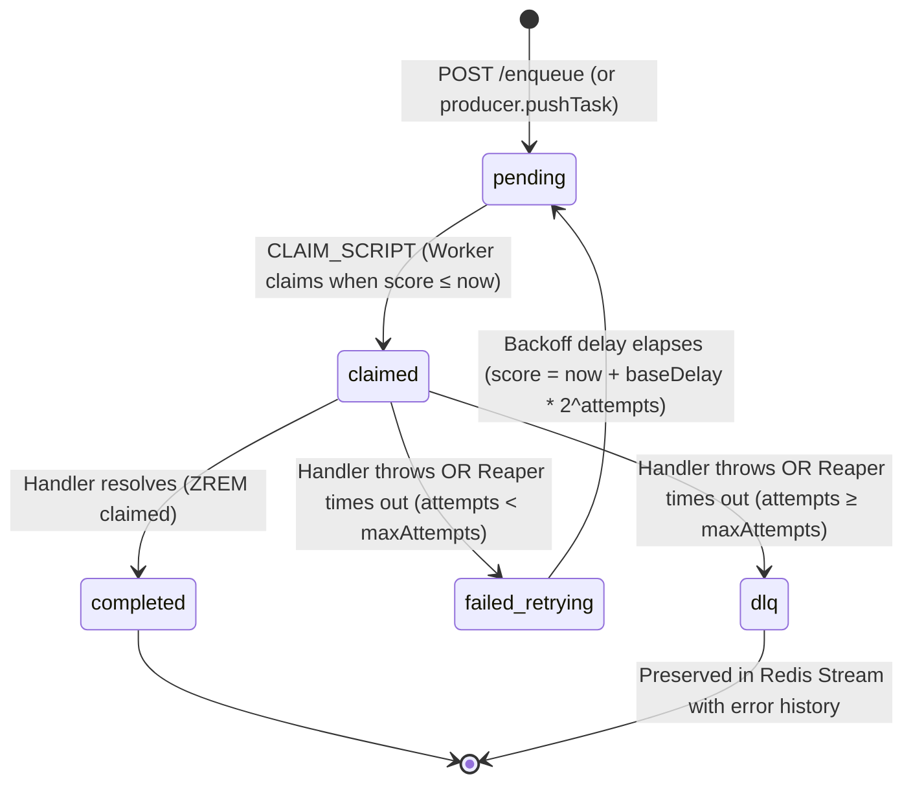

# Task Queue


A production-grade, distributed task queue engine written in TypeScript from the ground up — backed directly by Redis primitives with **zero third-party queue frameworks** (no BullMQ, Celery, or Bee-Queue).

Engineered with atomic claim mechanics via Redis Lua scripts, automatic crash recovery via an autonomous reaper process, exponential backoff retries, a dead-letter queue (DLQ) backed by Redis Streams, graceful shutdown lifecycle hooks, and an Express HTTP API with real-time queue metrics.

---

## Table of Contents

- [Overview](#overview)
- [System Architecture](#system-architecture)
- [Task Lifecycle State Machine](#task-lifecycle-state-machine)
- [Redis Data Model & Key Structure](#redis-data-model--key-structure)
- [Core Lua Scripts & Atomicity](#core-lua-scripts--atomicity)
  - [1. Atomic Task Claim (`CLAIM_SCRIPT`)](#1-atomic-task-claim-claim_script)
  - [2. Atomic Failure & Backoff / DLQ (`FAIL_SCRIPT`)](#2-atomic-failure--backoff--dlq-fail_script)
- [Key Features & Design Decisions](#key-features--design-decisions)
- [Configuration & Tunables](#configuration--tunables)
- [Quick Start](#quick-start)
  - [Option A: Docker Compose (Recommended)](#option-a-docker-compose-recommended)
  - [Option B: Running Locally (Native Node.js)](#option-b-running-locally-native-nodejs)
- [HTTP API Reference](#http-api-reference)
  - [1. Enqueue Task](#1-enqueue-task)
  - [2. Schedule Delayed Task](#2-schedule-delayed-task)
  - [3. Get Task Status](#3-get-task-status)
  - [4. Inspect Dead-Letter Queue (DLQ)](#4-inspect-dead-letter-queue-dlq)
  - [5. System Metrics](#5-system-metrics)
  - [6. Health Check](#6-health-check)
- [Extending Task Handlers](#extending-task-handlers)
- [Testing Architecture & Concurrency Verification](#testing-architecture--concurrency-verification)
- [Project Directory Structure](#project-directory-structure)

---

## Overview

Web APIs shouldn't stall on heavy workloads like webhooks, report exports, or third-party syncs. This engine acts as the asynchronous buffer:
1. **Producer / HTTP API** receives the request, stores the task, and returns `202 Accepted` immediately.
2. **Worker Pool** continuously polls and claims ready jobs using single-roundtrip Lua scripts that ensure strict exclusivity.
3. **Reaper Daemon** constantly patrols for abandoned tasks whose visibility timeout expired (e.g. if a worker node suffered an unhandled crash or OOM kill) and safely reclaims them.
4. **Retry & Backoff Engine** re-queues transient failures with exponential delay ($T_{\text{delay}} = \text{baseDelay} \times 2^{\text{attempts}}$) and dead-letters permanently failed jobs once the retry ceiling is hit.

The entire queue infrastructure relies purely on Redis sorted sets (`ZSET`), hashes (`HASH`), and streams (`STREAM`), eliminating black-box abstractions.

---

## System Architecture



---

## Task Lifecycle State Machine

Each task progresses through deterministic states recorded with a 24-hour TTL in Redis for external inspection:



| State | Redis Representation | Description |
|---|---|---|
| `pending` | In `pending` ZSET (`score = readyTime`) & `task:<id>` hash | Waiting to become ready or ready to be claimed. |
| `claimed` | In `claimed` ZSET (`score = deadline`) & `task:<id>` hash | Picked up by an active worker; visibility timeout ticking. |
| `completed` | Removed from all ZSETs; `task:<id>` marked `completed` | Successfully executed and acknowledged. |
| `failed_retrying` | In `pending` ZSET with future backoff score & `task:<id>` hash | Failed an execution attempt; waiting for exponential backoff delay to pass. |
| `dlq` | In `dlq` Stream & `task:<id>` hash marked `dlq` | Max retries exceeded; stored for manual inspection or dead-letter replay. |

---

## Redis Data Model & Key Structure

| Redis Key | Type | Member / Field | Score / Value | Purpose |
|---|---|---|---|---|
| `pending` | **Sorted Set (ZSET)** | JSON-stringified `Task` object | Unix Epoch (ms) when ready to run | Queue of ready and future-scheduled tasks. |
| `claimed` | **Sorted Set (ZSET)** | JSON-stringified `Task` object | Unix Epoch (ms) visibility deadline | In-flight tasks. Checked periodically by the reaper. |
| `dlq` | **Stream (STREAM)** | Stream Entry (`*`) | `taskId`, `type`, `payload`, `error`, `attempts` | Durable, chronologically append-only Dead-Letter Queue. |
| `task:<id>` | **Hash (HASH)** | `status`, `type`, `attempts`, `error`, `updatedAt` | String values | Best-effort task status tracking (`EXPIRE`: 24 hours). |
| `metrics` | **Hash (HASH)** | `completed`, `requeued`, `dlq` | Monotonically increasing counters | Running counters for queue throughput and outcome rates. |

---

## Core Lua Scripts & Atomicity

In distributed queue architectures, race conditions between multiple workers or between a worker and the reaper can lead to **double execution**, **lost tasks**, or **infinite loops**.

Rather than relying on client-side transactions (`WATCH`/`MULTI`/`EXEC`) which create optimistic-lock retry storms during high worker contention, this engine executes atomic logic within Redis using Lua.

### 1. Atomic Task Claim (`CLAIM_SCRIPT`)

```lua
local items = redis.call('ZRANGEBYSCORE', KEYS[1], '-inf', ARGV[2], 'LIMIT', 0, 1)
if #items == 0 then return nil end
local task = items[1]
redis.call('ZREM', KEYS[1], task)
redis.call('ZADD', KEYS[2], ARGV[1], task)
return task
```
- **Inputs**: `KEYS[1]` (`pending`), `KEYS[2]` (`claimed`), `ARGV[1]` (visibility deadline `now + 30s`), `ARGV[2]` (`now`).
- **Guarantee**: Atomically queries the oldest task ready to run (`score <= now`), removes it from `pending`, and places it into `claimed` with its visibility deadline. Exactly one worker receives the task.

### 2. Atomic Failure & Backoff / DLQ (`FAIL_SCRIPT`)

```lua
local removed = redis.call('ZREM', KEYS[1], ARGV[1])
if removed == 0 then return 0 end
local task = cjson.decode(ARGV[1])
task['attempts'] = task['attempts'] + 1
if task['attempts'] >= task['maxAttempts'] then
  redis.call('XADD', KEYS[3], '*',
    'taskId', task['id'],
    'type', task['type'],
    'payload', cjson.encode(task['payload']),
    'error', ARGV[4],
    'attempts', tostring(task['attempts'])
  )
  return 2
end
local delay = tonumber(ARGV[3]) * (2 ^ task['attempts'])
local score = tonumber(ARGV[2]) + delay
redis.call('ZADD', KEYS[2], score, cjson.encode(task))
return 1
```
- **Inputs**: `KEYS[1]` (`claimed`), `KEYS[2]` (`pending`), `KEYS[3]` (`dlq`), `ARGV[1]` (task JSON), `ARGV[2]` (`now`), `ARGV[3]` (`baseDelayMs`), `ARGV[4]` (`error`).
- **The Worker-Reaper Concurrency Shield**: The script executes `ZREM claimed task` first. If `removed == 0`, another process (e.g. the reaper timed out right as the worker finished, or vice versa) already acted on this task. The script immediately returns `0`, completely preventing duplicate retries or duplicate DLQ pushes.

---

## Key Features & Design Decisions

### 1. At-Least-Once Delivery Semantics
If a worker crashes after completing a task but before deleting it from `claimed`, the reaper will eventually re-claim the task once the visibility timeout expires. Therefore, task handlers must be **idempotent**. This is the standard trade-off in distributed systems without distributed transactions.

### 2. Visibility Timeouts vs. Heartbeats
The engine intentionally uses visibility timeouts (`VISIBILITY_TIMEOUT_MS = 30s`) rather than complex heartbeat sockets. Any crash, process termination, or hung event loop causes the task's deadline to pass, allowing the reaper to recover it.

### 3. Sorted Set Scheduling vs. Redis Lists
Redis lists (`LPUSH` / `BLPOP`) only support simple FIFO ordering. They cannot natively hold a task back until a scheduled execution time or backoff window has elapsed without separate sleep threads. Using a sorted set (`ZSET`) where `score = eligibleEpochMs` provides delayed task scheduling and exponential backoff naturally within a single unified queue.

### 4. Resilient Observability Separation
Updating `task:<id>` hashes or `metrics` counters is wrapped in non-blocking error guards. If Redis hash operations fail or encounter timeouts, the core queue operations (claiming, execution, ACK, retry) continue uninterrupted.

### 5. Graceful Process Shutdown
All services hook into `SIGTERM` and `SIGINT` signals using Node.js `AbortController` without abruptly killing tasks:
- **Worker pool**: Once a shutdown signal is dispatched, workers stop polling for new tasks (`while (!signal.aborted)`). The in-flight task currently executing runs to completion (or throws), updates Redis state, and closes its Redis client cleanly — there is no hard timeout cap forcing a premature worker kill.
- **Reaper**: Wakes immediately from its polling interval via `abortableSleep`, completing the current cycle and quitting cleanly.
- **HTTP API server**: Stops accepting new connections via `server.close()`. It arms a forced-exit timer with `SHUTDOWN_TIMEOUT_MS` (5 seconds) — if in-flight HTTP requests fail to drain within that window, `process.exit(1)` is triggered to prevent hanging indefinitely.

---

## Configuration & Tunables

All tunable parameters are centrally located in [`backend/src/config.ts`](backend/src/config.ts):

| Setting | Default Value | Description |
|---|---|---|
| `BASE_DELAY_MS` | `1000` (1s) | Base delay for exponential backoff ($1\text{s} \times 2^{\text{attempts}}$). |
| `MAX_ATTEMPTS` | `5` | Maximum execution attempts before routing to the DLQ. |
| `VISIBILITY_TIMEOUT_MS` | `30000` (30s) | Window before an in-flight claimed task is considered abandoned. |
| `POLL_INTERVAL_MS` | `500` (0.5s) | Polling frequency for workers checking for ready tasks. |
| `REAPER_INTERVAL_MS` | `10000` (10s) | Frequency at which the reaper scans for expired visibility deadlines. |
| `TASK_STATUS_TTL_SECONDS` | `86400` (24h) | Time-to-live for `task:<id>` status tracking hashes. |
| `SHUTDOWN_TIMEOUT_MS` | `5000` (5s) | Forced-exit timeout for the API server if active connections fail to drain (`server.ts`). |
| `PORT` | `3000` | Port for the Express HTTP API server (configurable via env `PORT`). |
| `REDIS_URL` | `redis://127.0.0.1:6379` | Redis connection URL (configurable via env `REDIS_URL`). |

---

## Quick Start

### Option A: Docker Compose (Recommended)

Starts the entire distributed topology — Redis, Worker Pool, Reaper Daemon, and HTTP API — in isolated containers:

```bash
# Build and spin up the complete stack in the background
docker compose up -d --build

# View real-time logs across all services
docker compose logs -f

# Shut down the stack
docker compose down
```

The HTTP API is exposed at `http://localhost:3000`.

### Option B: Running Locally (Native Node.js)

**Prerequisites:** Node.js 24+ and a running Redis instance on `localhost:6379`.

```bash
cd backend

# Install dependencies
npm install

# Compile TypeScript
npm run build

# Start services in separate terminal tabs:
npm run start:worker   # Starts the task worker
npm run start:reaper   # Starts the crash-recovery reaper
npm run start:api      # Starts the Express HTTP API server
```

---

## HTTP API Reference

### 1. Enqueue Task

Pushes a task onto the queue for immediate asynchronous execution.

```bash
curl -X POST http://localhost:3000/enqueue \
  -H "Content-Type: application/json" \
  -d '{
    "type": "log",
    "payload": { "message": "Process invoice #1042" }
  }'
```

**Response (`202 Accepted`):**
```json
{
  "taskId": "7b8e3ad2-8054-47be-b0f3-a7732a3f6562"
}
```

---

### 2. Schedule Delayed Task

Enqueue a task scheduled to become eligible at a specific future ISO 8601 timestamp.

```bash
curl -X POST http://localhost:3000/enqueue \
  -H "Content-Type: application/json" \
  -d '{
    "type": "webhook",
    "payload": {
      "url": "https://httpbin.org/post",
      "body": { "event": "subscription.renewed", "account": 9821 }
    },
    "runAt": "2026-10-15T12:00:00Z"
  }'
```

---

### 3. Get Task Status

Look up the real-time lifecycle status of any task.

```bash
curl http://localhost:3000/tasks/7b8e3ad2-8054-47be-b0f3-a7732a3f6562
```

**Response (`200 OK`):**
```json
{
  "status": "completed",
  "type": "log",
  "attempts": "0",
  "updatedAt": "2026-10-11T10:08:26.390Z"
}
```
*(Possible `status` values: `pending`, `claimed`, `completed`, `failed_retrying`, `dlq`)*

---

### 4. Inspect Dead-Letter Queue (DLQ)

Inspect dead-lettered tasks that exceeded their retry limit. Results are ordered newest-first with cursor-based pagination.

```bash
# Fetch latest 20 dead-lettered entries
curl "http://localhost:3000/dlq?limit=20"

# Fetch subsequent page using cursor
curl "http://localhost:3000/dlq?limit=20&before=1728641200000-0"
```

**Response (`200 OK`):**
```json
{
  "entries": [
    {
      "id": "1728641200000-0",
      "taskId": "c9284ea1-f8a4-4903-8d48-3908f5d0281b",
      "type": "webhook",
      "error": "webhook POST to https://api.invalid/hook failed: 500 Internal Server Error",
      "attempts": "5"
    }
  ],
  "nextCursor": null
}
```

---

### 5. System Metrics

Real-time health, live queue depths, and historical rate metrics.

```bash
curl http://localhost:3000/metrics
```

**Response (`200 OK`):**
```json
{
  "pending": 14,
  "inFlight": 2,
  "dlqSize": 1,
  "succeeded": 142,
  "requeued": 8,
  "failed": 1,
  "successRate": 0.993,
  "failureRate": 0.007
}
```
- `pending`, `inFlight`, and `dlqSize` are read live directly from Redis data structures (`ZCARD` & `XLEN`).
- `successRate` and `failureRate` calculate the ratio of tasks reaching a terminal state (`succeeded / (succeeded + failed)`).

---

### 6. Health Check

```bash
curl http://localhost:3000/health
```

**Response (`200 OK`):**
```json
{
  "status": "ok"
}
```
*(Returns `503 Service Unavailable` if Redis connectivity fails)*

---

## Extending Task Handlers

Handlers are defined as simple async functions that accept a `Task` and throw upon failure.

To register a new task type (e.g. `email`), add it to the handler map in [`backend/src/worker/worker.ts`](backend/src/worker/worker.ts):

```typescript
import type { TaskHandler } from "./worker.js";

const emailHandler: TaskHandler = async (task) => {
  const { to, subject, html } = task.payload as { to: string; subject: string; html: string };
  await sendEmailService({ to, subject, html });
};

// In main():
const handlers = new Map<string, TaskHandler>([
  ["log", logHandler],
  ["webhook", webhookHandler],
  ["email", emailHandler], // Registered here
]);
```

Any task enqueued with an unregistered `type` is safely caught, logged, and routed to the DLQ rather than silently dropped.

---

## Testing Architecture & Concurrency Verification

The test suite runs using Node's native test runner (`node:test`, `node:assert/strict`) without heavy testing dependencies (e.g., Jest or Mocha).

```bash
cd backend
npm test
```

### 4-Tier Testing Pyramid

| Test Layer | Test File | Target | Concurrency / Isolation Strategy |
|---|---|---|---|
| **1. Lua Script Unit** | [`scripts.test.ts`](backend/test/scripts.test.ts) | Direct `EVAL` of `CLAIM_SCRIPT` & `FAIL_SCRIPT` | **50 concurrent workers** fire simultaneous claims on the same task via `Promise.all` to verify zero double-claims. |
| **2. Component** | [`worker.test.ts`](backend/test/worker.test.ts)<br/>[`reaper.test.ts`](backend/test/reaper.test.ts)<br/>[`taskStatus.test.ts`](backend/test/taskStatus.test.ts) | Real worker and reaper loops running in-process against Redis | Verifies backoff timing, handler exceptions, malformed payload recovery, and visibility expiry. |
| **3. Integration** | [`routes.test.ts`](backend/test/routes.test.ts)<br/>[`metrics.test.ts`](backend/test/metrics.test.ts) | Express API routes exercised with `supertest` | Validates HTTP status codes, validation errors, DLQ cursor pagination, and metric math. |
| **4. Black-Box E2E** | [`e2e.test.ts`](backend/test/e2e.test.ts) | Spawns compiled Node processes (`child_process.spawn`) | Ensures CLI entrypoints run cleanly without module import side-effects. |

### Redis Database Isolation
Because Node's test runner executes test files concurrently, each test file dynamically isolates itself onto an independent Redis database index (e.g., `redis://localhost:6379/1`, `/2`, etc.), preventing cross-test data pollution and flush collisions.

---

## Project Directory Structure

```
task-queue/
├── docker-compose.yml           # Multi-container orchestration (Redis, Worker, Reaper, API)
├── backend/
│   ├── Dockerfile               # Node.js Alpine container definition
│   ├── package.json             # Scripts and dependencies
│   ├── tsconfig.json            # Strict TypeScript configuration
│   ├── src/
│   │   ├── config.ts            # Central configuration & tunable constants
│   │   ├── redisClient.ts       # Shared Redis connection provider
│   │   ├── shutdown.ts          # Graceful shutdown & abortable sleep helpers
│   │   ├── logger.ts            # Plain-text structured event logging
│   │   ├── entrypoint.ts        # ESM module execution guard
│   │   ├── types/
│   │   │   └── task.ts          # Core Task TypeScript interface
│   │   ├── producers/
│   │   │   └── producer.ts      # Enqueue logic & ZADD scoring
│   │   ├── worker/
│   │   │   ├── scripts.ts       # Atomic Lua claim and fail scripts
│   │   │   └── worker.ts        # Worker loop, dispatcher & handlers
│   │   ├── reaper/
│   │   │   └── reaper.ts        # Crash-recovery reaper daemon
│   │   └── api/
│   │       ├── app.ts           # Express application factory
│   │       ├── server.ts        # HTTP server bootstrap & shutdown handler
│   │       ├── taskStatus.ts    # Task status tracking helper (Redis Hash)
│   │       ├── metrics.ts       # Queue metrics counter helper (Redis Hash)
│   │       └── routes/          # REST route handlers
│   │           ├── enqueue.ts   # POST /enqueue
│   │           ├── tasks.ts     # GET /tasks/:id
│   │           ├── dlq.ts       # GET /dlq
│   │           ├── metrics.ts   # GET /metrics
│   │           └── health.ts    # GET /health
│   └── test/                    # 34 automated unit, integration, and E2E tests
│       ├── helpers/testRedis.ts # Isolated per-file Redis database allocator
│       ├── scripts.test.ts      # Concurrency & Lua script tests
│       ├── worker.test.ts       # Worker lifecycle tests
│       ├── reaper.test.ts       # Crash recovery tests
│       ├── routes.test.ts       # HTTP endpoint tests
│       ├── metrics.test.ts      # Metrics calculation tests
│       ├── taskStatus.test.ts   # Task status persistence tests
│       └── e2e.test.ts          # Black-box process spawn tests
└── README.md
```
